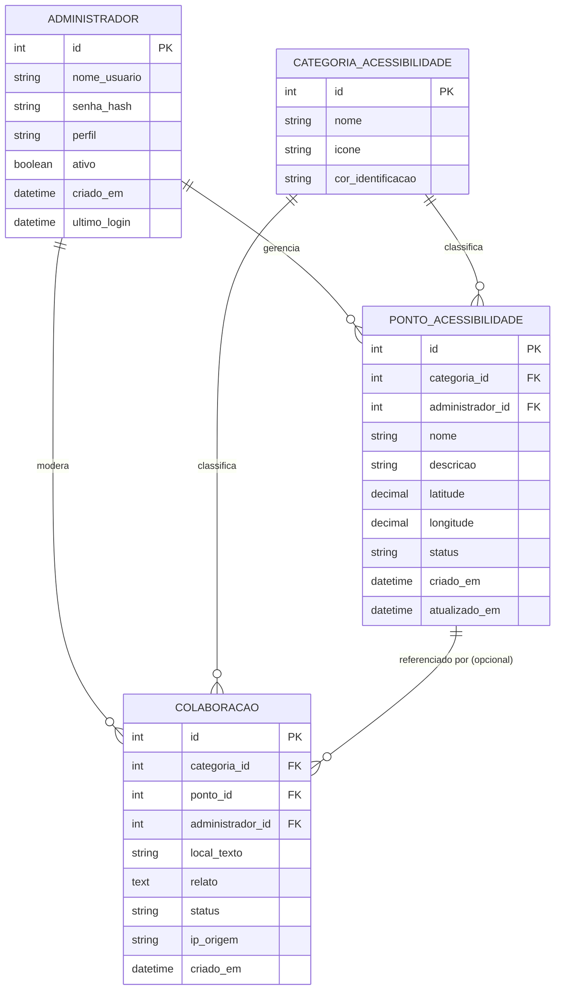
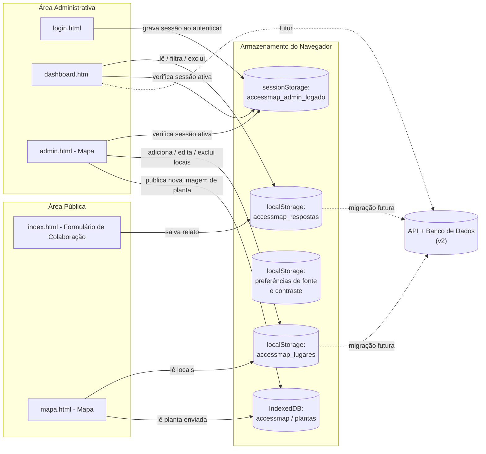

# AccessMap

**Mapeamento colaborativo de acessibilidade em espaços públicos**

> Projeto de Extensão — Tecnologia em Sistemas para Internet
> IFSP Campus Itapetininga — 2026/2027

---

## Sumário

- [Sobre o Projeto](#sobre-o-projeto)
- [Motivação](#motivação)
- [Impacto e Gestão Pública](#impacto-e-gestão-pública)
- [Funcionalidades](#funcionalidades)
- [Tecnologias Utilizadas](#tecnologias-utilizadas)
- [Estrutura do Projeto](#estrutura-do-projeto)
- [Arquitetura da Versão Atual (v1 — sem banco de dados)](#arquitetura-da-versão-atual-v1--sem-banco-de-dados)
- [Modelo de Dados](#modelo-de-dados)
  - [Visão Geral das Entidades](#visão-geral-das-entidades)
  - [Diagrama Entidade-Relacionamento](#diagrama-entidade-relacionamento)
  - [Dicionário de Dados](#dicionário-de-dados)
  - [Migração para Banco de Dados Real](#migração-para-banco-de-dados-real)
- [Fluxos do Sistema](#fluxos-do-sistema)
- [Acesso Administrativo (Ambiente de Avaliação)](#acesso-administrativo-ambiente-de-avaliação)
- [Como Executar Localmente](#como-executar-localmente)
- [Acessibilidade](#acessibilidade)
- [Roadmap](#roadmap)
- [Autoria e Desenvolvimento](#autoria-e-desenvolvimento)
- [Licença](#licença)

---

## Sobre o Projeto

O **AccessMap** é um projeto de extensão que visa mapear e catalogar pontos de acessibilidade dentro do **campus do IFSP Itapetininga**, promovendo a inclusão em sua forma mais ampla. Esta primeira versão do sistema foi pensada, modelada e implementada especificamente para a realidade do campus, servindo como piloto para validar a proposta.

Esta iniciativa surge da necessidade de oferecer suporte e orientação a alunos, servidores e visitantes. O campus recebe pessoas em contextos variados — do dia a dia letivo a eventos de grande porte que atraem públicos diversos — e ter um suporte de acessibilidade claro é essencial para garantir que todos tenham uma experiência inclusiva e autônoma no espaço.

O objetivo central vai além de facilitar a locomoção física: o AccessMap também contempla o suporte a dificuldades auditivas e visuais, unindo mapeamento geográfico, categorização de barreiras e um canal aberto de comunicação com a comunidade.

Embora o foco atual do projeto seja exclusivamente o campus do IFSP Itapetininga, pretende-se futuramente avaliar uma versão adaptável do AccessMap para outros espaços públicos, conforme detalhado no [Roadmap](#roadmap).

## Motivação

Espaços públicos — sejam eles instituições de ensino, órgãos públicos, parques ou centros culturais — frequentemente carecem de informação estruturada sobre suas condições de acessibilidade. Rampas mal sinalizadas, ausência de recursos para pessoas com deficiência auditiva, falta de rotas alternativas: tudo isso poderia ser mapeado e comunicado de forma simples, colaborativa e visual.

O AccessMap nasce dessa lacuna, propondo uma ferramenta que:

1. **Informa** — apresenta um mapa navegável com pontos de acessibilidade já identificados no campus;
2. **Escuta** — permite que qualquer visitante relate barreiras ou sugira melhorias, sem necessidade de cadastro;
3. **Organiza** — centraliza esses relatos em um painel administrativo, permitindo à gestão do campus priorizar ações.

## Impacto e Gestão Pública

Os dados coletados pelo AccessMap possuem um papel importante para a comunidade e para a gestão do campus:

- **Mapeamento de Necessidades** — identificação real do que precisa ser melhorado, a partir da voz de quem utiliza o espaço no dia a dia.
- **Propostas de Melhoria** — as informações coletadas podem ser estruturadas em relatórios para fundamentar pedidos de verba, emendas parlamentares ou projetos de captação de recursos.
- **Transparência** — demonstração clara e baseada em dados de onde os investimentos em infraestrutura inclusiva devem ser priorizados.

## Funcionalidades

### Área Pública (sem necessidade de login)

- Página inicial institucional com carrossel informativo (com botão de pausar), seção de estatísticas e apresentação do projeto.
- **Mapa interativo do campus** (`mapa.html`), com:
  - três plantas: Mapa Geral, Subsolo Edificações (Bloco C) e Subsolo Mecânica (Bloco B);
  - busca por nome ao digitar (ignora acentos e hífens) e Enter para ir direto ao local, trocando de planta se necessário;
  - filtros por acessibilidade física e auditiva e o botão "Ver todos";
  - **marcadores com ícone por área** — a cor indica onde o local fica e o ícone indica o que ele é (ver [Ícones e legenda do mapa](#ícones-e-legenda-do-mapa));
  - legenda recolhível com o significado de cores e ícones;
  - **plantas em alta resolução**, nítidas mesmo com zoom máximo, carregadas sob demanda para manter a página leve (ver [Imagens das plantas em alta resolução](#imagens-das-plantas-em-alta-resolução)).
- Formulário de colaboração, no qual qualquer visitante pode relatar um problema ou sugerir uma melhoria, informando:
  - Local da ocorrência;
  - Categoria de acessibilidade (física ou auditiva, com plano de expansão para outras categorias);
  - Relato ou sugestão em texto livre.

  O formulário valida os campos e mostra a mensagem de erro junto ao campo a corrigir.
- Widget de acessibilidade nativo (aumento/diminuição de fonte e alto contraste, com a preferência mantida entre as páginas) e integração com o **VLibras**, tradutor de Libras do Governo Federal.

#### Ícones e legenda do mapa

Cada local é exibido como um pino colorido com um ícone ([Font Awesome](https://fontawesome.com/)), seguindo uma regra única no mapa, na lista lateral e nos popups:

- **A cor diz onde fica**: Bloco A — Informática (bordô), Bloco B — Mecânica (azul-marinho), Bloco C — Edificações (verde), Bloco D (roxo) e cores próprias para estacionamento, quadra, refeitório e canteiro. Pontos de **acessibilidade física** ficam em azul (cor do Símbolo Internacional de Acessibilidade), de **acessibilidade auditiva** em magenta e **alertas** de barreira em amarelo, como uma placa de aviso.
- **O ícone diz o que é**: laboratório de informática, laboratório de mecânica, laboratório de construção, laboratório de ciências, sala de aula, sala dos professores, auditório, biblioteca, refeitório/cantina, secretaria e coordenações, estacionamento, quadra, banheiro, elevador, escada, rampa, vaga PCD, NAPNE, depósito, entre outros.

O ícone é escolhido automaticamente pelo nome do local (ex.: um local chamado "Bloco A - Banheiro…" recebe o ícone de banheiro) e, se o nome não for específico, pela área. Assim, locais novos cadastrados pelo administrador já recebem o ícone certo. Todas as regras ficam em `assets/js/icones-lugares.js`.

### Área Administrativa (restrita, mediante login)

Levantada na Fase 1 do cronograma do projeto, a área administrativa deve atender aos seguintes requisitos:

- O sistema deve exibir uma tela de dashboard com fácil visualização dos dados, contendo barra de rolagem e filtro de respostas para melhorar a usabilidade do administrador;
- O sistema deve permitir que o administrador acesse o mapa em modo administrativo a partir dessa mesma tela;
- O sistema deve permitir que o administrador edite os locais já cadastrados no campus, considerando eventuais alterações físicas do espaço;
- O sistema deve permitir que o administrador remova locais já pontuados no mapa;
- O sistema deve permitir que o administrador adicione novos locais na planta atual do campus apenas por meio de um clique no ponto desejado dentro do mapa;
- O sistema deve garantir uma experiência intuitiva para o administrador ao longo de todo o fluxo administrativo;
- O sistema deve permitir que o administrador organize e exclua as respostas recebidas pelo formulário principal de feedback, de modo a manter esse fluxo de respostas mais claro e gerenciável.

Nesta versão, os requisitos acima estão implementados da seguinte forma:

- Autenticação de administrador, com proteção de `dashboard.html` e `admin.html` (sem login, o acesso é redirecionado para `login.html`) e botão **Sair** em todas as páginas administrativas.
- Dashboard de respostas coletadas pelo formulário público, com:
  - Filtro por local;
  - Filtro por categoria de acessibilidade;
  - Busca por palavra-chave no relato;
  - Ordenação (mais recentes, mais antigos, ordem alfabética por local);
  - Exclusão de respostas já tratadas, com opção de **Desfazer**;
  - Contador de respostas e mensagens distintas para "ainda não há respostas" e "nenhum resultado para os filtros".
- Edição de pontos do mapa (`admin.html`):
  - inserção de novos locais por clique direto sobre o mapa, com captura automática das coordenadas (X, Y) na planta;
  - painel lateral de edição que mantém o mapa clicável para ajustar a posição;
  - escolha do tipo do local (ponto de interesse, acessibilidade física, acessibilidade auditiva ou alerta) e do bloco/setor;
  - edição e exclusão de locais existentes, sempre com confirmação;
  - aviso de nome duplicado e mensagens de erro no próprio formulário;
  - alterações salvas no navegador, refletidas no mapa público e com opção de **restaurar a lista original**.
- **Atualização da imagem do mapa** (planta), para quando o campus mudar: envio de nova imagem com pré-visualização, aviso de proporção diferente ou de resolução baixa, e opções **Voltar ao mapa anterior** e **Restaurar original**.

## Tecnologias Utilizadas

| Camada | Tecnologia | Finalidade |
|---|---|---|
| Estrutura | **HTML5** | Marcação semântica e acessível |
| Estilo | **SASS (SCSS)** | Estilização avançada, arquitetura modular e design responsivo |
| Interatividade | **JavaScript (Vanilla)** | Carrossel, menus, autenticação, formulário, dashboard, interação com o mapa |
| Persistência (atual) | **Web Storage API** (`localStorage` / `sessionStorage`) e **IndexedDB** | Simulação de banco de dados no navegador enquanto não há back-end; o IndexedDB guarda as imagens de planta enviadas pelo admin |
| Ícones | **Font Awesome 6** | Iconografia da interface e ícones dos locais no mapa |
| Tipografia | **Google Fonts** (Montserrat e Open Sans) | Fontes da identidade visual |
| Acessibilidade | **VLibras** (Governo Federal) | Tradução de conteúdo para Libras |
| Mapas | **Leaflet 1.9.4** | Mapa interativo das plantas do campus (`CRS.Simple`) |
| Imagens | **WebP**, **Real-ESRGAN** e **ImageMagick** | Plantas em alta resolução: ampliação 4x com IA e geração das imagens base e dos pedaços HD |

> A escolha por manter a v1 inteiramente funcional no front-end, sem depender de um back-end ou banco de dados, foi proposital: garante que a aplicação possa ser avaliada, testada e demonstrada em qualquer navegador, sem necessidade de infraestrutura de servidor.

## Estrutura do Projeto

```
accessmap-ifsp/
├── assets/
│   ├── css/
│   │   ├── style.css          # CSS compilado de scss/style.scss (todas as páginas)
│   │   └── admin.css          # CSS compilado de scss/admin.scss (só admin.html)
│   ├── scss/                  # Código-fonte dos estilos (partials _*.scss)
│   ├── images/                # Logos, ícones, fotos da equipe, slides
│   │   ├── planta-*.png       # Desenhos originais das plantas (fonte, 1920x1080)
│   │   └── plantas/<ala>/     # Plantas usadas no mapa: base.webp + hd/ (alta resolução)
│   └── js/
│       ├── acessibilidade.js  # A+/A-, alto contraste e VLibras (todas as páginas)
│       ├── script.js          # Menu, carrossel e formulário público (index.html)
│       ├── authentication.js  # Login e proteção das páginas do administrador
│       ├── dashboard.js       # Leitura/filtro/exclusão (com desfazer) de respostas
│       ├── icones-lugares.js  # Cores, ícones e legenda dos locais do mapa
│       ├── mapa.js            # Dados dos locais, busca, filtros, navegação e plantas HD
│       ├── admin.js           # Inserir/editar/excluir locais (admin.html)
│       ├── plantas-storage.js # Imagens de planta no IndexedDB
│       └── admin-planta.js    # Modal "Atualizar imagem do mapa" (admin.html)
├── scripts/
│   └── gerar-plantas-hd.sh    # Gera base.webp e os pedaços HD de uma planta
├── index.html                 # Página institucional / pública
├── login.html                 # Login exclusivo do administrador
├── dashboard.html              # Painel administrativo (protegido)
├── admin.html                  # Edição de pontos do mapa (protegido)
├── mapa.html                    # Mapa interativo do campus
├── README.md
└── LICENSE
```

## Arquitetura da Versão Atual (v1 — sem banco de dados)

Como o projeto ainda não possui um back-end, toda a "persistência de dados" da v1 é feita no próprio navegador, através da **Web Storage API** e do **IndexedDB**, o que permite que o sistema funcione de ponta a ponta — captação de relatos, login administrativo, cadastro de pontos no mapa e visualização no dashboard — sem depender de servidor.

| Mecanismo | Uso no AccessMap | Escopo |
|---|---|---|
| `sessionStorage` | Guarda o estado de sessão do administrador logado (`accessmap_admin_logado`) | Expira ao fechar o navegador |
| `localStorage` | Guarda as colaborações enviadas pelo formulário público (`accessmap_respostas`), os locais do mapa depois que o admin adiciona/edita/exclui algum (`accessmap_lugares`) e as preferências de alto contraste (`altoContrasteState`) e tamanho da fonte (`accessmap_nivel_fonte`) | Persiste entre sessões, no mesmo navegador/dispositivo |
| IndexedDB | Guarda as imagens de planta enviadas pelo admin (banco `accessmap`, tabela `plantas`), com a versão anterior para desfazer | Persiste entre sessões, no mesmo navegador/dispositivo |

Essa abordagem tem uma limitação intencional e conhecida: os dados ficam restritos ao navegador/dispositivo em que foram inseridos, não sendo compartilhados entre diferentes usuários ou máquinas. Isso é aceitável para fins de demonstração e avaliação acadêmica da v1, mas será substituído por um back-end real (API + banco de dados) nas próximas versões — ver [Migração para Banco de Dados Real](#migração-para-banco-de-dados-real).

## Modelo de Dados

Mesmo sem um banco de dados implementado na v1, o projeto já foi modelado pensando na estrutura relacional que sustentará as próximas versões, com foco no funcionamento do sistema dentro do campus do IFSP Itapetininga.

### Visão Geral das Entidades

- **Administrador** — usuário com acesso à área restrita do sistema, responsável por gerenciar os pontos do mapa e moderar as colaborações recebidas.
- **PontoAcessibilidade** — um local específico do campus que foi mapeado (ex: "Rampa - Bloco A"), com sua categoria, coordenadas e status.
- **Colaboracao** — um relato ou sugestão enviado pelo público através do formulário, podendo opcionalmente referenciar um Ponto de Acessibilidade já existente.
- **CategoriaAcessibilidade** — tabela de apoio que padroniza as categorias disponíveis (física, auditiva, visual, etc.), permitindo adicionar novas categorias sem alterar código.

### Diagrama Entidade-Relacionamento



### Diagrama de Fluxo de Dados (v1 — sem banco de dados)

Para tornar explícito como a v1 simula esse modelo relacional usando apenas o navegador, o diagrama abaixo mostra o fluxo real de dados hoje:



### Dicionário de Dados

#### Tabela `administrador`

| Campo | Tipo | Obrigatório | Descrição |
|---|---|---|---|
| `id` | INT (PK) | Sim | Identificador único do administrador |
| `nome_usuario` | VARCHAR(80) | Sim | Login utilizado para acesso |
| `senha_hash` | VARCHAR(255) | Sim | Senha armazenada com hash (nunca em texto puro) |
| `perfil` | VARCHAR(20) | Sim | Nível de acesso (`admin`, `superadmin`) |
| `ativo` | BOOLEAN | Sim | Indica se a conta está habilitada |
| `criado_em` | DATETIME | Sim | Data de criação da conta |
| `ultimo_login` | DATETIME | Não | Data/hora do último acesso, para fins de auditoria |

> Na v1 (sem banco de dados), esta tabela é substituída por uma única conta de teste fixa, definida em `authentication.js`, exclusivamente para fins de avaliação acadêmica — ver [Acesso Administrativo](#acesso-administrativo-ambiente-de-avaliação).

#### Tabela `categoria_acessibilidade`

| Campo | Tipo | Obrigatório | Descrição |
|---|---|---|---|
| `id` | INT (PK) | Sim | Identificador único da categoria |
| `nome` | VARCHAR(50) | Sim | Nome da categoria (ex: "Física", "Auditiva", "Visual") |
| `icone` | VARCHAR(50) | Não | Classe do ícone (Font Awesome) usada na interface |
| `cor_identificacao` | VARCHAR(7) | Não | Cor em hexadecimal usada para identificar a categoria visualmente |

> Modelar a categoria como tabela própria (em vez de um valor fixo no código) é o que permite, futuramente, adicionar novas categorias de acessibilidade sem alterar o front-end.
>
> Na v1, os campos `icone` e `cor_identificacao` já são aplicados na interface pelo arquivo `assets/js/icones-lugares.js`, que define a cor de cada área e tipo de acessibilidade e o ícone de cada tipo de local.

#### Tabela `ponto_acessibilidade`

| Campo | Tipo | Obrigatório | Descrição |
|---|---|---|---|
| `id` | INT (PK) | Sim | Identificador único do ponto mapeado |
| `categoria_id` | INT (FK → categoria_acessibilidade.id) | Sim | Categoria de acessibilidade do ponto |
| `administrador_id` | INT (FK → administrador.id) | Não | Administrador responsável pelo cadastro/edição do ponto |
| `nome` | VARCHAR(150) | Sim | Nome do ponto (ex: "Rampa de acesso - Bloco A") |
| `descricao` | TEXT | Não | Descrição detalhada do ponto e suas condições |
| `latitude` | DECIMAL(10,7) | Sim | Coordenada geográfica do ponto, capturada automaticamente pelo clique no mapa |
| `longitude` | DECIMAL(10,7) | Sim | Coordenada geográfica do ponto, capturada automaticamente pelo clique no mapa |
| `status` | VARCHAR(20) | Sim | Situação do ponto (`ativo`, `em_manutencao`, `inativo`) |
| `criado_em` | DATETIME | Sim | Data de cadastro do ponto |
| `atualizado_em` | DATETIME | Não | Data da última atualização do ponto |

> Na v1, os pontos ficam no array `lugares` (em `mapa.js`) e, depois que o administrador altera algum, em `localStorage` sob a chave `accessmap_lugares`. Cada ponto tem os campos `nome`, `tipo` (`geral`, `fisica`, `auditiva` ou `alerta`), `categoria`, `andar` (`terreo` ou `subsolo`), `bloco_pai`, `subponto` e as coordenadas `x` e `y`. Como o mapa usa as plantas do campus (e não um mapa geográfico), `x`/`y` são posições na planta, que farão o papel de `longitude`/`latitude` no modelo completo.

#### Tabela `colaboracao`

| Campo | Tipo | Obrigatório | Descrição |
|---|---|---|---|
| `id` | INT (PK) | Sim | Identificador único da colaboração/relato |
| `categoria_id` | INT (FK → categoria_acessibilidade.id) | Sim | Categoria de acessibilidade relatada |
| `ponto_id` | INT (FK → ponto_acessibilidade.id) | Não | Ponto de acessibilidade relacionado, se já cadastrado |
| `administrador_id` | INT (FK → administrador.id) | Não | Administrador responsável pela moderação/exclusão do relato |
| `local_texto` | VARCHAR(150) | Sim | Local informado livremente pelo usuário no formulário |
| `relato` | TEXT | Sim | Descrição do problema ou sugestão enviada |
| `status` | VARCHAR(20) | Sim | Situação do relato (`pendente`, `em_analise`, `resolvido`) |
| `ip_origem` | VARCHAR(45) | Não | Endereço IP de origem, para fins de moderação/antispam |
| `criado_em` | DATETIME | Sim | Data e hora do envio do relato |

> Na v1, esta tabela corresponde exatamente ao objeto salvo em `localStorage` sob a chave `accessmap_respostas`, com os campos `id`, `local`, `categoria`, `relato` e `data` — um subconjunto simplificado do modelo completo, já que ainda não há o conceito de `ponto_acessibilidade` vinculado nem de `administrador_id` de moderação.

### Migração para Banco de Dados Real

Quando o projeto avançar para uma versão com back-end, a proposta é que a transição siga estes passos, sem quebrar a experiência já validada na v1:

1. Substituir as funções `lerRespostasForm()` / `salvarNovaResposta()` (em `script.js`) e `lerRespostas()` / `salvarRespostas()` (em `dashboard.js`) por chamadas `fetch` a uma API REST (`GET/POST/DELETE /colaboracoes`).
2. Substituir a autenticação fixa em `authentication.js` por uma rota de login real (`POST /auth/login`), retornando um token de sessão (JWT ou similar) em vez de uma flag no `sessionStorage`.
3. Substituir `carregarLugaresSalvos()` / `salvarLugares()` (em `mapa.js`), que hoje gravam os locais em `localStorage`, por chamadas a uma API (`GET/POST/PUT/DELETE /pontos`), persistindo coordenadas, tipo e categoria no banco de dados real.
4. Substituir o armazenamento das imagens de planta no IndexedDB (`plantas-storage.js`) por envio a um servidor de arquivos (`POST/GET/DELETE /plantas/:ala`).
5. Popular a tabela `categoria_acessibilidade` com as categorias já usadas na v1 (física, auditiva) e abrir espaço para novas categorias (visual, cognitiva, etc.).
6. Migrar os registros já existentes no `localStorage` (se necessário, via rotina de importação) para as novas tabelas `ponto_acessibilidade` e `colaboracao`.

## Fluxos do Sistema

### Fluxo do visitante (colaboração)

1. O visitante acessa `index.html` e preenche o formulário de colaboração na seção "Contato".
2. Seleciona a categoria de acessibilidade (física ou auditiva) e descreve o relato.
3. Ao enviar, o relato é validado (com mensagem de erro junto ao campo que falta) e salvo no armazenamento local do navegador.
4. Uma mensagem de sucesso é exibida e o formulário é limpo, sem necessidade de recarregar a página.

### Fluxo do visitante (mapa)

1. O visitante abre `mapa.html` pela página inicial ("Ir para o mapa").
2. Escolhe a planta (Mapa Geral ou um dos subsolos), busca um local pelo nome ou filtra por acessibilidade física/auditiva.
3. Ao clicar em um local da lista ou em um marcador, o mapa se aproxima e mostra o nome, o tipo e a área do local; a legenda explica cores e ícones.

### Fluxo do administrador

1. O administrador acessa `login.html` e informa usuário e senha da conta de teste.
2. Após autenticação, é redirecionado para `dashboard.html`.
3. O painel carrega automaticamente todas as colaborações já registradas, permitindo filtrar, ordenar e excluir relatos.
4. A partir do dashboard, o administrador acessa `admin.html` para editar o mapa, podendo clicar em um ponto do mapa para cadastrar um novo local, editar um local existente ou removê-lo, e também atualizar a imagem de uma planta, retornando ao dashboard ao final.
5. Tentativas de acessar `dashboard.html` ou `admin.html` diretamente, sem login prévio, são redirecionadas de volta para `login.html`.

## Acesso Administrativo (Ambiente de Avaliação)

Para fins de avaliação acadêmica da disciplina, foi disponibilizada uma conta de teste com perfil de administrador, criada exclusivamente para esse propósito — **não é uma credencial pessoal nem reutilizada em outros sistemas**:

```
Usuário: admin.teste
Senha:   Avaliacao@2025
```

Essa conta permite o acesso completo às telas e funcionalidades da área administrativa (backend visual do sistema), incluindo o dashboard de colaborações recebidas pelo formulário público e a edição de pontos do mapa.

> ⚠️ Esta autenticação é implementada inteiramente no front-end (JavaScript), como solução temporária enquanto não há back-end. Não deve ser considerada uma implementação segura para produção.

## Como Executar Localmente

Por não depender de back-end ou banco de dados, o projeto pode ser executado inteiramente no navegador:

1. Clone o repositório:
   ```bash
   git clone https://github.com/m4halic3/accessmap-ifsp.git
   cd accessmap-ifsp
   ```
2. Sirva a pasta com um servidor local simples (recomendado, pois alguns navegadores restringem `localStorage`/IndexedDB em arquivos abertos via `file://`), por exemplo:
   ```bash
   python3 -m http.server 8000
   # ou: npx serve .
   ```
   e acesse `http://localhost:8000`.
3. Para acessar a área administrativa, use a [conta de teste](#acesso-administrativo-ambiente-de-avaliação) na tela de login.

### Editando os estilos (SCSS)

Os arquivos em `assets/css/` são gerados — edite os `.scss` em `assets/scss/` e recompile:

```bash
npx sass assets/scss/style.scss assets/css/style.css --style=compressed
npx sass assets/scss/admin.scss assets/css/admin.css --style=compressed
```

### Imagens das plantas em alta resolução

Para o mapa continuar nítido no zoom sem deixar a página pesada, cada planta é servida em duas camadas:

- `assets/images/plantas/<ala>/base.webp` — imagem leve, sempre carregada;
- `assets/images/plantas/<ala>/hd/L-C.webp` — a planta em alta resolução cortada em 6x4 pedaços, que o `mapa.js` só baixa quando o zoom pede mais detalhe, e apenas os que estão na tela.

As versões em alta resolução foram obtidas ampliando os desenhos originais (`planta-*.png`) 4x com o [Real-ESRGAN](https://github.com/xinntao/Real-ESRGAN) (modelo `realesrgan-x4plus`). Para refazer uma planta (ex.: depois de redesenhá-la):

```bash
# 1. Ampliar 4x com IA (binário realesrgan-ncnn-vulkan, da página de releases do projeto)
realesrgan-ncnn-vulkan -i assets/images/planta-campus.png -o campus-x4.png -n realesrgan-x4plus -t 64

# 2. Gerar base + pedaços HD (a área de coordenadas é a de plantas[ala] no mapa.js)
scripts/gerar-plantas-hd.sh todos campus-x4.png 1500 1056
scripts/gerar-plantas-hd.sh edificacoes edificacoes-x4.png 1200 800
scripts/gerar-plantas-hd.sh mecanica mecanica-x4.png 1200 800
```

> Imagens enviadas pelo admin em "Atualizar imagem do mapa" são exibidas inteiras (sem os pedaços HD); para ficarem nítidas no zoom, envie-as em alta resolução — o próprio formulário avisa quando a resolução é baixa.

### Testando os locais do mapa

1. No admin, clique em qualquer ponto do mapa: o painel **Inserir local** abre ao lado, e o mapa continua clicável para ajustar a posição.
2. Preencha o nome, escolha o tipo e clique em **Adicionar local**. O local fica salvo neste navegador e aparece também em `mapa.html` (busque pelo nome).
3. Para voltar à lista original, use **Restaurar lista original de locais**, no fim da barra lateral.

### Testando a atualização da imagem do mapa

1. Faça login e clique em **Ir para Edição do Mapa** (`admin.html`).
2. Clique em **Atualizar imagem do mapa**, escolha qual planta será trocada (Mapa Geral ou um dos subsolos) e selecione uma imagem PNG, JPG ou WEBP (até 25 MB, mínimo 300×300 px). Para os pontos continuarem no lugar, use a mesma proporção e o mesmo enquadramento da planta atual; para ficar nítida no zoom, envie em alta resolução (ideal: 6000 px de largura no Mapa Geral e 4800 px nos subsolos).
3. Clique em **Publicar novo mapa** e confirme. A nova imagem aparece na hora no admin e também em `mapa.html` (no mesmo navegador).
4. Para desfazer, abra o mesmo modal e use **Voltar ao mapa anterior** ou **Restaurar original**.

> As imagens enviadas ficam guardadas no IndexedDB do navegador (`accessmap` → `plantas`), seguindo a mesma limitação da v1: valem apenas para o navegador/dispositivo onde foram enviadas.

## Acessibilidade

O AccessMap foi desenvolvido com preocupação constante em ser acessível enquanto ferramenta — e não apenas em seu conteúdo:

- Marcação semântica em HTML5, com uso de `aria-label`, `role` e `fieldset`/`legend` nos formulários.
- Widget nativo de controle de tamanho de fonte e alto contraste, disponível em todas as páginas, com a preferência mantida ao navegar entre elas.
- Integração com o **VLibras** para tradução de conteúdo em Libras (se o serviço estiver fora do ar, a página continua funcionando).
- Navegação completa por teclado: botões reais nos filtros e listas, foco sempre visível, menu mobile com Enter/Espaço e Esc, painéis e modais que fecham com Esc.
- Link "Pular para o conteúdo" no início de cada página.
- Mensagens de status e erro anunciadas por leitores de tela (`aria-live`, `role="alert"`) e campos inválidos marcados com `aria-invalid`.
- Marcadores do mapa com nome acessível (ex.: "Bloco A - Biblioteca. Biblioteca — Bloco A — Informática") e significado que não depende só da cor: cada pino também tem um ícone, explicado na legenda.
- Carrossel com botão de pausar, que também para com o mouse ou o foco em cima (WCAG 2.2.2).
- Respeito à preferência do sistema por **menos movimento** (`prefers-reduced-motion`): animações e a troca automática do carrossel são desativadas.

## Roadmap

- [ ] Implementação de back-end com API REST e banco de dados relacional, conforme modelo apresentado em [Modelo de Dados](#modelo-de-dados).
- [ ] Testes de viabilidade do Leaflet integrado a um banco de dados real, avaliando camadas dinâmicas e performance.
- [ ] Autenticação administrativa real, com hash de senha e gerenciamento de sessão no servidor.
- [ ] Relatórios exportáveis (PDF/planilha) das colaborações recebidas, para uso em pedidos de verba e emendas parlamentares.
- [ ] Expansão das categorias de acessibilidade (visual, cognitiva, etc.).
- [ ] Sistema de status para colaborações (pendente, em análise, resolvido) com retorno visível à comunidade.
- [ ] Avaliação de uma versão adaptável do AccessMap para uso em outros espaços públicos além do campus do IFSP Itapetininga, incluindo eventuais ajustes no modelo de dados para suportar múltiplos locais.

## Autoria e Desenvolvimento

Ambas as autoras são estudantes de Tecnologia em Sistemas para Internet no IFSP Campus Itapetininga:

- **Mariana Alice**
- **Yasmim Vitória**

## Licença

Este projeto está licenciado sob os termos da **Licença MIT**. Veja o arquivo [LICENSE](./LICENSE) para o texto completo.

Em resumo, a Licença MIT permite que qualquer pessoa utilize, copie, modifique e distribua este software — inclusive para fins comerciais — desde que o aviso de copyright original e a própria licença sejam mantidos, e sem que os autores assumam qualquer responsabilidade pelo uso do software.

---

**IFSP Campus Itapetininga**
Projeto de Extensão — 2026/2027