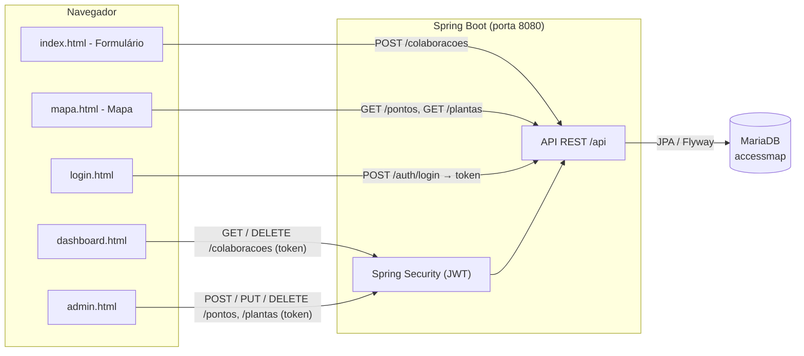
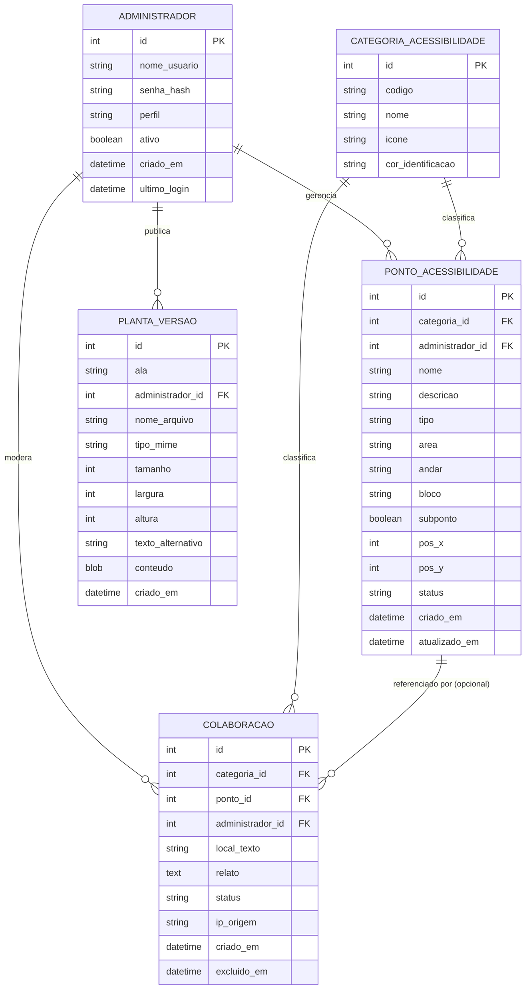

# AccessMap

**Mapeamento colaborativo de acessibilidade em espaços públicos**

> Projeto de Extensão — Tecnologia em Sistemas para Internet
> IFSP Campus Itapetininga — 2026/2027

---

## Sumário

- [Sobre o Projeto](#sobre-o-projeto)
- [Motivação](#motivação)
- [Impacto e Gestão Pública](#impacto-e-gestão-pública)
- [Funcionalidades](#funcionalidades)
- [Tecnologias Utilizadas](#tecnologias-utilizadas)
- [Estrutura do Projeto](#estrutura-do-projeto)
- [Arquitetura (v2 — API REST + banco de dados)](#arquitetura-v2--api-rest--banco-de-dados)
  - [Rotas da API](#rotas-da-api)
- [Modelo de Dados](#modelo-de-dados)
  - [Visão Geral das Entidades](#visão-geral-das-entidades)
  - [Diagrama Entidade-Relacionamento](#diagrama-entidade-relacionamento)
  - [Dicionário de Dados](#dicionário-de-dados)
  - [Migração da v1 para o Banco de Dados](#migração-da-v1-para-o-banco-de-dados)
- [Fluxos do Sistema](#fluxos-do-sistema)
- [Acesso Administrativo (Ambiente de Avaliação)](#acesso-administrativo-ambiente-de-avaliação)
- [Como Executar Localmente](#como-executar-localmente)
- [Acessibilidade](#acessibilidade)
- [Roadmap](#roadmap)
- [Autoria e Desenvolvimento](#autoria-e-desenvolvimento)
- [Licença](#licença)

---

## Sobre o Projeto

O **AccessMap** é um projeto de extensão que visa mapear e catalogar pontos de acessibilidade dentro do **campus do IFSP Itapetininga**, promovendo a inclusão em sua forma mais ampla. Esta primeira versão do sistema foi pensada, modelada e implementada especificamente para a realidade do campus, servindo como piloto para validar a proposta.

Esta iniciativa surge da necessidade de oferecer suporte e orientação a alunos, servidores e visitantes. O campus recebe pessoas em contextos variados — do dia a dia letivo a eventos de grande porte que atraem públicos diversos — e ter um suporte de acessibilidade claro é essencial para garantir que todos tenham uma experiência inclusiva e autônoma no espaço.

O objetivo central vai além de facilitar a locomoção física: o AccessMap também contempla o suporte a dificuldades auditivas e visuais, unindo mapeamento geográfico, categorização de barreiras e um canal aberto de comunicação com a comunidade.

Embora o foco atual do projeto seja exclusivamente o campus do IFSP Itapetininga, pretende-se futuramente avaliar uma versão adaptável do AccessMap para outros espaços públicos, conforme detalhado no [Roadmap](#roadmap).

## Motivação

Espaços públicos — sejam eles instituições de ensino, órgãos públicos, parques ou centros culturais — frequentemente carecem de informação estruturada sobre suas condições de acessibilidade. Rampas mal sinalizadas, ausência de recursos para pessoas com deficiência auditiva, falta de rotas alternativas: tudo isso poderia ser mapeado e comunicado de forma simples, colaborativa e visual.

O AccessMap nasce dessa lacuna, propondo uma ferramenta que:

1. **Informa** — apresenta um mapa navegável com pontos de acessibilidade já identificados no campus;
2. **Escuta** — permite que qualquer visitante relate barreiras ou sugira melhorias, sem necessidade de cadastro;
3. **Organiza** — centraliza esses relatos em um painel administrativo, permitindo à gestão do campus priorizar ações.

## Impacto e Gestão Pública

Os dados coletados pelo AccessMap possuem um papel importante para a comunidade e para a gestão do campus:

- **Mapeamento de Necessidades** — identificação real do que precisa ser melhorado, a partir da voz de quem utiliza o espaço no dia a dia.
- **Propostas de Melhoria** — as informações coletadas podem ser estruturadas em relatórios para fundamentar pedidos de verba, emendas parlamentares ou projetos de captação de recursos.
- **Transparência** — demonstração clara e baseada em dados de onde os investimentos em infraestrutura inclusiva devem ser priorizados.

## Funcionalidades

### Área Pública (sem necessidade de login)

- Página inicial institucional com carrossel informativo (com botão de pausar), seção de estatísticas e apresentação do projeto.
- **Mapa interativo do campus** (`mapa.html`), com:
  - três plantas: Mapa Geral, Subsolo Edificações (Bloco C) e Subsolo Mecânica (Bloco B);
  - busca por nome ao digitar (ignora acentos e hífens) e Enter para ir direto ao local, trocando de planta se necessário;
  - filtros por acessibilidade física e auditiva e o botão "Ver todos";
  - **locais exibidos pelo nome**, com um ícone por área, e **pinos apenas para pontos de acessibilidade e alertas** (ver [Ícones e legenda do mapa](#ícones-e-legenda-do-mapa));
  - **informações reveladas conforme o zoom**: ao abrir, o mapa mostra só a planta, limpa; ao aproximar, aparecem os prédios, as áreas principais e os pontos de acessibilidade e, aproximando mais, as salas — sem que os nomes se sobreponham;
  - legenda recolhível com o significado de cores e ícones;
  - **plantas em alta resolução**, nítidas mesmo com zoom máximo, carregadas sob demanda para manter a página leve (ver [Imagens das plantas em alta resolução](#imagens-das-plantas-em-alta-resolução));
  - **layout responsivo**: no computador, barra lateral ao lado do mapa; no celular e no tablet, o mapa ocupa a tela inteira e a barra lateral vira um **painel deslizante** na parte de baixo (recolhido mostra a busca e a escolha da planta; expandido, os filtros, a legenda e a lista), como em aplicativos de mapa.
- Formulário de colaboração, no qual qualquer visitante pode relatar um problema ou sugerir uma melhoria, informando:
  - Local da ocorrência;
  - Categoria de acessibilidade (física ou auditiva, com plano de expansão para outras categorias);
  - Relato ou sugestão em texto livre.

  O formulário valida os campos e mostra a mensagem de erro junto ao campo a corrigir; o servidor repete a validação antes de gravar o relato no banco de dados.
- Widget de acessibilidade nativo (aumento/diminuição de fonte e alto contraste, com a preferência mantida entre as páginas) e integração com o **VLibras**, tradutor de Libras do Governo Federal.

#### Ícones e legenda do mapa

No mapa, os locais do campus aparecem pelo **nome**, acompanhado de um pequeno ícone; **pinos** são usados apenas para o que é o foco do projeto — pontos de acessibilidade física, auditiva e alertas de barreira. Os prédios aparecem como etiquetas destacadas.

O que aparece depende do zoom (como em mapas do tipo Airbnb): ao abrir a tela, o mapa fica limpo, só com a planta; no primeiro passo de zoom aparecem os prédios, as áreas principais (estacionamentos, quadra, refeitório…) e os pinos de acessibilidade; aproximando mais, os nomes das salas vão surgindo. A busca, os filtros de acessibilidade e o local aberto pela lista lateral são exibidos mesmo sem zoom. Os nomes nunca se sobrepõem — os mais importantes têm prioridade e os demais aparecem quando há espaço na tela. Na busca, os resultados ficam destacados e o restante do mapa fica esmaecido. No modo administrador, clicar no nome de um local abre a edição dele.

Ícones e cores seguem uma regra única no mapa, na lista lateral e nos popups ([Font Awesome](https://fontawesome.com/)):

- **A cor diz onde fica**: Bloco A — Informática (bordô), Bloco B — Mecânica (azul-marinho), Bloco C — Edificações (verde), Bloco D (roxo) e cores próprias para estacionamento, quadra, refeitório e canteiro. Pontos de **acessibilidade física** ficam em azul (cor do Símbolo Internacional de Acessibilidade), de **acessibilidade auditiva** em magenta e **alertas** de barreira em amarelo, como uma placa de aviso.
- **O ícone diz o que é**: laboratório de informática, laboratório de mecânica, laboratório de construção, laboratório de ciências, sala de aula, sala dos professores, auditório, biblioteca, refeitório/cantina, secretaria e coordenações, estacionamento, quadra, banheiro, elevador, escada, rampa, vaga PCD, NAPNE, depósito, entre outros.

O ícone é escolhido automaticamente pelo nome do local (ex.: um local chamado "Bloco A - Banheiro…" recebe o ícone de banheiro) e, se o nome não for específico, pela área. Assim, locais novos cadastrados pelo administrador já recebem o ícone certo. Todas as regras ficam em `assets/js/icones-lugares.js`.

### Área Administrativa (restrita, mediante login)

Levantada na Fase 1 do cronograma do projeto, a área administrativa deve atender aos seguintes requisitos:

- O sistema deve exibir uma tela de dashboard com fácil visualização dos dados, contendo barra de rolagem e filtro de respostas para melhorar a usabilidade do administrador;
- O sistema deve permitir que o administrador acesse o mapa em modo administrativo a partir dessa mesma tela;
- O sistema deve permitir que o administrador edite os locais já cadastrados no campus, considerando eventuais alterações físicas do espaço;
- O sistema deve permitir que o administrador remova locais já pontuados no mapa;
- O sistema deve permitir que o administrador adicione novos locais na planta atual do campus apenas por meio de um clique no ponto desejado dentro do mapa;
- O sistema deve garantir uma experiência intuitiva para o administrador ao longo de todo o fluxo administrativo;
- O sistema deve permitir que o administrador organize e exclua as respostas recebidas pelo formulário principal de feedback, de modo a manter esse fluxo de respostas mais claro e gerenciável.

Nesta versão, os requisitos acima estão implementados da seguinte forma:

- Autenticação de administrador no servidor (senha guardada com hash BCrypt e token de sessão JWT válido por 8 horas), com proteção de `dashboard.html` e `admin.html` (sem login, o acesso é redirecionado para `login.html`) e botão **Sair** em todas as páginas administrativas.
- Dashboard de respostas coletadas pelo formulário público, com:
  - Filtro por local;
  - Filtro por categoria de acessibilidade;
  - Busca por palavra-chave no relato;
  - Ordenação (mais recentes, mais antigos, ordem alfabética por local);
  - Exclusão de respostas já tratadas, com opção de **Desfazer** (a exclusão é lógica: o registro fica no banco, marcado com a data e o administrador que excluiu);
  - Contador de respostas e mensagens distintas para "ainda não há respostas" e "nenhum resultado para os filtros".
- Edição de pontos do mapa (`admin.html`):
  - inserção de novos locais por clique direto sobre o mapa, com captura automática das coordenadas (X, Y) na planta;
  - painel lateral de edição que mantém o mapa clicável para ajustar a posição;
  - escolha do tipo do local (ponto de interesse, acessibilidade física, acessibilidade auditiva ou alerta) e do bloco/setor;
  - edição e exclusão de locais existentes, sempre com confirmação;
  - aviso de nome duplicado e mensagens de erro no próprio formulário;
  - alterações gravadas no banco de dados, refletidas no mapa público de todos os visitantes, com opção de **restaurar a lista original**.
- **Atualização da imagem do mapa** (planta), para quando o campus mudar: envio de nova imagem com pré-visualização, aviso de proporção diferente ou de resolução baixa, e opções **Voltar ao mapa anterior** e **Restaurar original**. As imagens ficam guardadas no banco de dados.

## Tecnologias Utilizadas

| Camada | Tecnologia | Finalidade |
|---|---|---|
| Estrutura | **HTML5** | Marcação semântica e acessível |
| Estilo | **SASS (SCSS)** | Estilização avançada, arquitetura modular e design responsivo |
| Interatividade | **JavaScript (Vanilla)** | Carrossel, menus, autenticação, formulário, dashboard, interação com o mapa |
| Back-end | **Java 21** + **Spring Boot 3.5** (Spring Web, Spring Data JPA, Spring Security, Bean Validation) | API REST, regras de negócio, autenticação e entrega das páginas do site |
| Banco de dados | **MariaDB 11** (compatível com MySQL) + **Flyway** | Persistência de locais, colaborações, administradores e imagens de planta; o Flyway cria e versiona as tabelas |
| Autenticação | **BCrypt** + **JWT** | Senhas guardadas com hash; token de sessão enviado no cabeçalho `Authorization` |
| Infraestrutura | **Docker Compose** | Sobe o banco de dados com um comando |
| Persistência no navegador | **Web Storage API** (`localStorage` / `sessionStorage`) | Só preferências do visitante (fonte e contraste) e o token de sessão do administrador |
| Ícones | **Font Awesome 6** | Iconografia da interface e ícones dos locais no mapa |
| Tipografia | **Google Fonts** (Montserrat e Open Sans) | Fontes da identidade visual |
| Acessibilidade | **VLibras** (Governo Federal) | Tradução de conteúdo para Libras |
| Mapas | **Leaflet 1.9.4** | Mapa interativo das plantas do campus (`CRS.Simple`) |
| Imagens | **WebP**, **Real-ESRGAN** e **ImageMagick** | Plantas em alta resolução: ampliação 4x com IA e geração das imagens base e dos pedaços HD |

> A v1 funcionava inteiramente no navegador, sem servidor, o que permitiu validar a proposta rapidamente. A v2 mantém a mesma interface e passa a persistir os dados em um banco de dados real, compartilhado por todos os visitantes. Se o servidor estiver fora do ar, o mapa público continua funcionando com a lista original de locais.

## Estrutura do Projeto

```
accessmap-ifsp/
├── assets/
│   ├── css/
│   │   ├── style.css          # CSS compilado de scss/style.scss (todas as páginas)
│   │   └── admin.css          # CSS compilado de scss/admin.scss (só admin.html)
│   ├── scss/                  # Código-fonte dos estilos (partials _*.scss)
│   ├── data/
│   │   └── locais-originais.json # Lista original de locais (popula o banco e serve de reserva)
│   ├── images/                # Logos, ícones, fotos da equipe, slides
│   │   ├── planta-*.png       # Desenhos originais das plantas (fonte, 1920x1080)
│   │   └── plantas/<ala>/     # Plantas usadas no mapa: base.webp + hd/ (alta resolução)
│   └── js/
│       ├── api.js             # Chamadas à API (fetch) e sessão do administrador
│       ├── acessibilidade.js  # A+/A-, alto contraste e VLibras (todas as páginas)
│       ├── script.js          # Menu, carrossel e formulário público (index.html)
│       ├── authentication.js  # Login e proteção das páginas do administrador
│       ├── dashboard.js       # Leitura/filtro/exclusão (com desfazer) de respostas
│       ├── icones-lugares.js  # Cores, ícones e legenda dos locais do mapa
│       ├── mapa.js            # Carga dos locais, busca, filtros, navegação e plantas HD
│       ├── sidebar-mapa.js    # Painel deslizante da barra lateral no celular/tablet
│       ├── admin.js           # Inserir/editar/excluir locais (admin.html)
│       ├── plantas-storage.js # Imagens de planta enviadas pelo admin (via API)
│       └── admin-planta.js    # Modal "Atualizar imagem do mapa" (admin.html)
├── backend/                   # API REST (Spring Boot)
│   ├── pom.xml / mvnw         # Build Maven (mvnw dispensa instalar o Maven)
│   └── src/main/
│       ├── java/br/edu/ifsp/accessmap/
│       │   ├── config/        # Segurança (JWT, CORS), entrega do site e configurações
│       │   ├── dominio/       # Entidades JPA (tabelas)
│       │   ├── repositorio/   # Acesso ao banco (Spring Data)
│       │   ├── dto/           # Formatos de entrada e saída da API
│       │   ├── servico/       # Regras de negócio e carga inicial
│       │   └── web/           # Controllers (rotas /api) e tratamento de erros
│       └── resources/
│           ├── application.properties
│           └── db/migration/  # Scripts SQL do Flyway (criação das tabelas)
├── scripts/
│   └── gerar-plantas-hd.sh    # Gera base.webp e os pedaços HD de uma planta
├── docker-compose.yml         # Banco de dados MariaDB
├── index.html                 # Página institucional / pública
├── login.html                 # Login exclusivo do administrador
├── dashboard.html             # Painel administrativo (protegido)
├── admin.html                 # Edição de pontos do mapa (protegido)
├── mapa.html                  # Mapa interativo do campus
├── README.md
└── LICENSE
```

## Arquitetura (v2 — API REST + banco de dados)

O front-end continua em HTML, SCSS e JavaScript puro. Toda a persistência passou para um back-end em **Spring Boot**, que expõe uma **API REST** em `/api` e grava os dados em um banco **MariaDB**. O mesmo servidor também entrega as páginas do site, então o navegador acessa site e API pelo mesmo endereço (`http://localhost:8080`).



- **Camadas do back-end:** `web` (controllers) → `servico` (regras de negócio) → `repositorio` (Spring Data JPA) → banco. Os erros de validação e de regra de negócio voltam em JSON (`{ "mensagem": ... }`) e o front-end mostra a mensagem ao usuário.
- **Validação nas duas pontas:** o front-end valida para dar retorno imediato e o servidor valida de novo antes de gravar (tamanhos, campos obrigatórios, tipos permitidos, nomes repetidos, formato real das imagens).
- **Autenticação:** o login confere a senha com o hash BCrypt da tabela `administrador` e devolve um token JWT, que o navegador guarda no `sessionStorage` e envia no cabeçalho `Authorization`. As rotas de escrita (e a leitura das colaborações) exigem o token.
- **Carga inicial:** na primeira execução, com o banco vazio, o servidor cria a conta de administrador e cadastra os 135 locais de `assets/data/locais-originais.json`.
- **Reserva:** se a API não responder, o mapa público usa essa mesma lista original, só para leitura.

| Ainda no navegador | Uso |
|---|---|
| `sessionStorage` (`accessmap_token`) | Token de sessão do administrador; expira ao fechar o navegador ou após 8 horas |
| `localStorage` | Preferências de alto contraste (`altoContrasteState`) e tamanho da fonte (`accessmap_nivel_fonte`) |

### Rotas da API

| Método e rota | Acesso | Descrição |
|---|---|---|
| `POST /api/auth/login` | Público | Login: `{ usuario, senha }` → `{ token, expiraEm, usuario }` |
| `GET /api/auth/sessao` | Admin | Confere se o token ainda é válido |
| `GET /api/pontos` | Público | Lista os locais do mapa |
| `POST /api/pontos` | Admin | Cadastra um local |
| `PUT /api/pontos/{id}` | Admin | Atualiza um local |
| `DELETE /api/pontos/{id}` | Admin | Exclui um local |
| `POST /api/pontos/restaurar-originais` | Admin | Volta à lista original de locais |
| `POST /api/colaboracoes` | Público | Envia um relato: `{ local, categoria, relato }` |
| `GET /api/colaboracoes` | Admin | Lista os relatos (não excluídos) |
| `DELETE /api/colaboracoes/{id}` | Admin | Exclui um relato (exclusão lógica) |
| `POST /api/colaboracoes/{id}/restaurar` | Admin | Desfaz a exclusão |
| `GET /api/categorias` | Público | Categorias de acessibilidade |
| `GET /api/plantas` | Público | Imagens de planta enviadas que estão em uso |
| `GET /api/plantas/arquivos/{id}` | Público | Arquivo de uma imagem de planta |
| `POST /api/plantas/{ala}` | Admin | Publica nova imagem (multipart: `arquivo`, `largura`, `altura`, `alt`) |
| `POST /api/plantas/{ala}/voltar` | Admin | Volta ao mapa anterior |
| `DELETE /api/plantas/{ala}` | Admin | Restaura a imagem original |

`{ala}` é `todos` (Mapa Geral), `edificacoes` ou `mecanica`.

## Modelo de Dados

O modelo relacional, planejado desde a v1, está implementado no MariaDB. As tabelas são criadas pelo Flyway a partir de `backend/src/main/resources/db/migration/V1__esquema_inicial.sql`.

### Visão Geral das Entidades

- **Administrador** — usuário com acesso à área restrita do sistema, responsável por gerenciar os pontos do mapa e moderar as colaborações recebidas.
- **PontoAcessibilidade** — um local específico do campus que foi mapeado (ex: "Rampa - Bloco A"), com sua categoria, coordenadas e status.
- **Colaboracao** — um relato ou sugestão enviado pelo público através do formulário, podendo opcionalmente referenciar um Ponto de Acessibilidade já existente.
- **CategoriaAcessibilidade** — tabela de apoio que padroniza as categorias disponíveis (física, auditiva, visual, etc.), permitindo adicionar novas categorias sem alterar código.
- **PlantaVersao** — imagem de planta enviada pelo administrador para uma ala do mapa (a versão em uso e a anterior).

### Diagrama Entidade-Relacionamento



### Dicionário de Dados

#### Tabela `administrador`

| Campo | Tipo | Obrigatório | Descrição |
|---|---|---|---|
| `id` | INT (PK) | Sim | Identificador único do administrador |
| `nome_usuario` | VARCHAR(80) | Sim | Login utilizado para acesso |
| `senha_hash` | VARCHAR(255) | Sim | Senha armazenada com hash (nunca em texto puro) |
| `perfil` | VARCHAR(20) | Sim | Nível de acesso (`admin`, `superadmin`) |
| `ativo` | BOOLEAN | Sim | Indica se a conta está habilitada |
| `criado_em` | DATETIME | Sim | Data de criação da conta |
| `ultimo_login` | DATETIME | Não | Data/hora do último acesso, para fins de auditoria |

> Na primeira execução, o servidor cria a conta definida em `accessmap.admin.usuario` / `accessmap.admin.senha` (por padrão, a [conta de avaliação](#acesso-administrativo-ambiente-de-avaliação)), com perfil `superadmin`.

#### Tabela `categoria_acessibilidade`

| Campo | Tipo | Obrigatório | Descrição |
|---|---|---|---|
| `id` | INT (PK) | Sim | Identificador único da categoria |
| `codigo` | VARCHAR(30) | Sim | Identificador usado pela API e pelo front-end (ex: `fisica`, `auditiva`) — único |
| `nome` | VARCHAR(50) | Sim | Nome da categoria (ex: "Física", "Auditiva", "Visual") |
| `icone` | VARCHAR(50) | Não | Classe do ícone (Font Awesome) usada na interface |
| `cor_identificacao` | VARCHAR(7) | Não | Cor em hexadecimal usada para identificar a categoria visualmente |

> Modelar a categoria como tabela própria (em vez de um valor fixo no código) é o que permite, futuramente, adicionar novas categorias de acessibilidade sem alterar o front-end.
>
> A tabela começa com as categorias `fisica` e `auditiva`. Na interface, cores e ícones ainda são aplicados por `assets/js/icones-lugares.js`.

#### Tabela `ponto_acessibilidade`

| Campo | Tipo | Obrigatório | Descrição |
|---|---|---|---|
| `id` | INT (PK) | Sim | Identificador único do ponto mapeado |
| `categoria_id` | INT (FK → categoria_acessibilidade.id) | Só se `tipo` = `acessibilidade` | Categoria de acessibilidade do ponto |
| `administrador_id` | INT (FK → administrador.id) | Não | Último administrador que cadastrou/editou o ponto |
| `nome` | VARCHAR(150) | Sim | Nome do ponto (ex: "Rampa de acesso - Bloco A") — único, sem diferenciar maiúsculas e acentos |
| `descricao` | TEXT | Não | Descrição detalhada do ponto e suas condições |
| `tipo` | VARCHAR(20) | Sim | `geral` (ponto de interesse), `acessibilidade` ou `alerta` |
| `area` | VARCHAR(40) | Sim | Área/uso do local, que define cor e ícone (ex: `salas_aula`, `rampa`, `informatica`) |
| `andar` | VARCHAR(10) | Sim | `terreo` ou `subsolo` |
| `bloco` | VARCHAR(40) | Não | Bloco a que pertence (`informatica`, `mecanica`, `edificacoes`, `administrativo`) |
| `subponto` | BOOLEAN | Sim | `true` para salas e pontos internos (aparecem com mais zoom) |
| `pos_x` / `pos_y` | INT | Sim | Posição na planta, capturada pelo clique no mapa |
| `status` | VARCHAR(20) | Sim | Situação do ponto (`ativo`, `em_manutencao`, `inativo`) |
| `criado_em` | DATETIME | Sim | Data de cadastro do ponto |
| `atualizado_em` | DATETIME | Não | Data da última atualização do ponto |

> Como o mapa usa as plantas do campus (e não um mapa geográfico), a posição é guardada em coordenadas da planta (`pos_x`/`pos_y`) no lugar de latitude/longitude. Na API, os campos seguem os nomes usados pelo front-end: `tipo` vem como `fisica`/`auditiva` (o código da categoria), `geral` ou `alerta`; `categoria` = `area`; `bloco_pai` = `bloco`; `x`/`y` = `pos_x`/`pos_y`.

#### Tabela `colaboracao`

| Campo | Tipo | Obrigatório | Descrição |
|---|---|---|---|
| `id` | INT (PK) | Sim | Identificador único da colaboração/relato |
| `categoria_id` | INT (FK → categoria_acessibilidade.id) | Sim | Categoria de acessibilidade relatada |
| `ponto_id` | INT (FK → ponto_acessibilidade.id) | Não | Ponto de acessibilidade relacionado, se já cadastrado |
| `administrador_id` | INT (FK → administrador.id) | Não | Administrador responsável pela moderação/exclusão do relato |
| `local_texto` | VARCHAR(150) | Sim | Local informado livremente pelo usuário no formulário |
| `relato` | TEXT | Sim | Descrição do problema ou sugestão enviada |
| `status` | VARCHAR(20) | Sim | Situação do relato (`pendente`, `em_analise`, `resolvido`) |
| `ip_origem` | VARCHAR(45) | Não | Endereço IP de origem, para fins de moderação/antispam |
| `criado_em` | DATETIME | Sim | Data e hora do envio do relato |
| `excluido_em` | DATETIME | Não | Preenchido quando o administrador exclui o relato no dashboard (exclusão lógica, permite desfazer) |

> Quando o local digitado no formulário é o nome de um local do mapa, o servidor já preenche `ponto_id`. Na API, os campos aparecem como na v1: `local`, `categoria`, `relato` e `data`.

#### Tabela `planta_versao`

| Campo | Tipo | Obrigatório | Descrição |
|---|---|---|---|
| `id` | INT (PK) | Sim | Identificador da versão |
| `ala` | VARCHAR(20) | Sim | Planta a que se refere: `todos`, `edificacoes` ou `mecanica` |
| `administrador_id` | INT (FK → administrador.id) | Não | Quem publicou |
| `nome_arquivo` | VARCHAR(255) | Sim | Nome do arquivo enviado |
| `tipo_mime` | VARCHAR(30) | Sim | `image/png`, `image/jpeg` ou `image/webp` (identificado pelo conteúdo do arquivo) |
| `tamanho` / `largura` / `altura` | INT | Sim | Tamanho em bytes e dimensões em pixels |
| `texto_alternativo` | VARCHAR(300) | Não | Descrição da imagem para leitores de tela |
| `conteudo` | LONGBLOB | Sim | A imagem (até 25 MB) |
| `criado_em` | DATETIME | Sim | Data da publicação |

> A versão em uso é a de maior `id` da ala; a anterior é guardada para **Voltar ao mapa anterior**. Ao publicar, versões mais antigas que essas duas são apagadas. Sem nenhuma linha para a ala, o mapa usa a imagem original do projeto.

### Migração da v1 para o Banco de Dados

O plano de migração da v1 foi executado assim:

1. ✅ `lerRespostasForm()` / `salvarNovaResposta()` (em `script.js`) e `lerRespostas()` / `salvarRespostas()` (em `dashboard.js`) foram substituídas por chamadas à API `/api/colaboracoes`.
2. ✅ A conta fixa de `authentication.js` deu lugar à rota `POST /api/auth/login`, que devolve um token JWT.
3. ✅ `carregarLugaresSalvos()` / `salvarLugares()` (em `mapa.js`) deram lugar a `GET/POST/PUT/DELETE /api/pontos`.
4. ✅ O IndexedDB de `plantas-storage.js` deu lugar a `/api/plantas/{ala}`, com as imagens guardadas no banco.
5. ✅ A tabela `categoria_acessibilidade` foi populada com `fisica` e `auditiva`.
6. ⚠️ Dados que tenham ficado no `localStorage`/IndexedDB de algum navegador durante a v1 **não** são importados automaticamente. A lista original de locais é cadastrada no banco na primeira execução.

## Fluxos do Sistema

### Fluxo do visitante (colaboração)

1. O visitante acessa `index.html` e preenche o formulário de colaboração na seção "Contato".
2. Seleciona a categoria de acessibilidade (física ou auditiva) e descreve o relato.
3. Ao enviar, o relato é validado (com mensagem de erro junto ao campo que falta), enviado à API e gravado na tabela `colaboracao`.
4. Uma mensagem de sucesso é exibida e o formulário é limpo, sem necessidade de recarregar a página.

### Fluxo do visitante (mapa)

1. O visitante abre `mapa.html` pela página inicial ("Ir para o mapa").
2. Escolhe a planta (Mapa Geral ou um dos subsolos), busca um local pelo nome ou filtra por acessibilidade física/auditiva.
3. Ao clicar em um local da lista ou em um marcador, o mapa se aproxima e mostra o nome, o tipo e a área do local; a legenda explica cores e ícones.

### Fluxo do administrador

1. O administrador acessa `login.html` e informa usuário e senha; o servidor confere a senha e devolve o token de sessão.
2. Após autenticação, é redirecionado para `dashboard.html`.
3. O painel carrega automaticamente todas as colaborações já registradas, permitindo filtrar, ordenar e excluir relatos.
4. A partir do dashboard, o administrador acessa `admin.html` para editar o mapa, podendo clicar em um ponto do mapa para cadastrar um novo local, editar um local existente ou removê-lo, e também atualizar a imagem de uma planta, retornando ao dashboard ao final.
5. Tentativas de acessar `dashboard.html` ou `admin.html` diretamente, sem login prévio, são redirecionadas de volta para `login.html`.

## Acesso Administrativo (Ambiente de Avaliação)

Para fins de avaliação acadêmica da disciplina, foi disponibilizada uma conta de teste com perfil de administrador, criada exclusivamente para esse propósito — **não é uma credencial pessoal nem reutilizada em outros sistemas**:

```
Usuário: admin.teste
Senha:   Avaliacao@2025
```

Essa conta permite o acesso completo às telas e funcionalidades da área administrativa (backend visual do sistema), incluindo o dashboard de colaborações recebidas pelo formulário público e a edição de pontos do mapa.

A conta é criada pelo servidor na primeira execução, com a senha guardada em hash (BCrypt). Fora do ambiente de avaliação, defina outras credenciais pelas variáveis `ACCESSMAP_ADMIN_USUARIO` e `ACCESSMAP_ADMIN_SENHA` **antes** da primeira execução, e um segredo fixo para os tokens em `ACCESSMAP_JWT_SEGREDO` (mínimo de 32 caracteres; sem ele, um segredo aleatório é gerado e os administradores precisam entrar de novo a cada reinício do servidor).

## Como Executar Localmente

Requisitos: **Java 21** e **Docker** (para o banco de dados). O Maven não precisa estar instalado, porque o projeto traz o `mvnw`.

1. Clone o repositório:
   ```bash
   git clone https://github.com/m4halic3/accessmap-ifsp.git
   cd accessmap-ifsp
   ```
2. Suba o banco de dados (MariaDB):
   ```bash
   docker compose up -d
   ```
3. Inicie o back-end:
   ```bash
   cd backend
   ./mvnw spring-boot:run
   ```
   Na primeira vez, o Flyway cria as tabelas e o servidor cadastra a conta de administrador e os locais originais.
4. Acesse `http://localhost:8080`. O site e a API são servidos juntos.
5. Para acessar a área administrativa, use a [conta de teste](#acesso-administrativo-ambiente-de-avaliação) na tela de login.

Configurações (todas opcionais, com valores padrão que batem com o `docker-compose.yml`):

| Variável | Padrão | Para que serve |
|---|---|---|
| `ACCESSMAP_DB_URL` | `jdbc:mariadb://localhost:3306/accessmap` | Endereço do banco |
| `ACCESSMAP_DB_USUARIO` / `ACCESSMAP_DB_SENHA` | `accessmap` / `accessmap` | Usuário do banco |
| `ACCESSMAP_ADMIN_USUARIO` / `ACCESSMAP_ADMIN_SENHA` | conta de avaliação | Conta criada na primeira execução |
| `ACCESSMAP_JWT_SEGREDO` | aleatório a cada início | Segredo dos tokens de login (mín. 32 caracteres) |
| `ACCESSMAP_FRONTEND_DIR` | `..` (raiz do projeto) | Pasta do site servida pelo back-end |
| `PORT` | `8080` | Porta do servidor |

Para gerar um `.jar` e rodar sem o Maven: `./mvnw package` e `java -jar target/accessmap-2.0.0.jar` (a partir da pasta `backend/`).

> Também é possível servir o front-end separado (ex.: `python3 -m http.server 8000` na raiz). Nesse caso, defina `window.ACCESSMAP_API_URL = "http://localhost:8080/api"` antes de `api.js`. As origens `localhost:8000` já estão liberadas no CORS (`ACCESSMAP_CORS_ORIGENS`). Sem o back-end, o mapa público abre com a lista original de locais, mas formulário, login e edição não funcionam.

### Editando os estilos (SCSS)

Os arquivos em `assets/css/` são gerados — edite os `.scss` em `assets/scss/` e recompile:

```bash
npx sass assets/scss/style.scss assets/css/style.css --style=compressed
npx sass assets/scss/admin.scss assets/css/admin.css --style=compressed
```

### Imagens das plantas em alta resolução

Para o mapa continuar nítido no zoom sem deixar a página pesada, cada planta é servida em duas camadas:

- `assets/images/plantas/<ala>/base.webp` — imagem leve, sempre carregada;
- `assets/images/plantas/<ala>/hd/L-C.webp` — a planta em alta resolução cortada em 6x4 pedaços, que o `mapa.js` só baixa quando o zoom pede mais detalhe, e apenas os que estão na tela.

As versões em alta resolução foram obtidas ampliando os desenhos originais (`planta-*.png`) 4x com o [Real-ESRGAN](https://github.com/xinntao/Real-ESRGAN) (modelo `realesrgan-x4plus`). Para refazer uma planta (ex.: depois de redesenhá-la):

```bash
# 1. Ampliar 4x com IA (binário realesrgan-ncnn-vulkan, da página de releases do projeto)
realesrgan-ncnn-vulkan -i assets/images/planta-campus.png -o campus-x4.png -n realesrgan-x4plus -t 64

# 2. Gerar base + pedaços HD (a área de coordenadas é a de plantas[ala] no mapa.js)
scripts/gerar-plantas-hd.sh todos campus-x4.png 1500 1056
scripts/gerar-plantas-hd.sh edificacoes edificacoes-x4.png 1200 800
scripts/gerar-plantas-hd.sh mecanica mecanica-x4.png 1200 800
```

> Imagens enviadas pelo admin em "Atualizar imagem do mapa" são exibidas inteiras (sem os pedaços HD); para ficarem nítidas no zoom, envie-as em alta resolução — o próprio formulário avisa quando a resolução é baixa.

### Testando os locais do mapa

1. No admin, clique em qualquer ponto do mapa: o painel **Inserir local** abre ao lado, e o mapa continua clicável para ajustar a posição.
2. Preencha o nome, escolha o tipo e clique em **Adicionar local**. O local é gravado no banco de dados e aparece em `mapa.html` para qualquer visitante (busque pelo nome).
3. Para voltar à lista original, use **Restaurar lista original de locais**, no fim da barra lateral.

### Testando a atualização da imagem do mapa

1. Faça login e clique em **Ir para Edição do Mapa** (`admin.html`).
2. Clique em **Atualizar imagem do mapa**, escolha qual planta será trocada (Mapa Geral ou um dos subsolos) e selecione uma imagem PNG, JPG ou WEBP (até 25 MB, mínimo 300×300 px). Para os pontos continuarem no lugar, use a mesma proporção e o mesmo enquadramento da planta atual; para ficar nítida no zoom, envie em alta resolução (ideal: 6000 px de largura no Mapa Geral e 4800 px nos subsolos).
3. Clique em **Publicar novo mapa** e confirme. A nova imagem é enviada ao servidor e aparece na hora no admin e em `mapa.html`, para qualquer visitante.
4. Para desfazer, abra o mesmo modal e use **Voltar ao mapa anterior** ou **Restaurar original**.

> As imagens enviadas ficam guardadas no banco de dados (tabela `planta_versao`).

## Acessibilidade

O AccessMap foi desenvolvido com preocupação constante em ser acessível enquanto ferramenta — e não apenas em seu conteúdo:

- Marcação semântica em HTML5, com uso de `aria-label`, `role` e `fieldset`/`legend` nos formulários.
- Widget nativo de controle de tamanho de fonte e alto contraste, disponível em todas as páginas, com a preferência mantida ao navegar entre elas.
- Integração com o **VLibras** para tradução de conteúdo em Libras (se o serviço estiver fora do ar, a página continua funcionando).
- Navegação completa por teclado: botões reais nos filtros e listas, foco sempre visível, menu mobile com Enter/Espaço e Esc, painéis e modais que fecham com Esc.
- Link "Pular para o conteúdo" no início de cada página.
- Mensagens de status e erro anunciadas por leitores de tela (`aria-live`, `role="alert"`) e campos inválidos marcados com `aria-invalid`.
- Marcadores do mapa com nome acessível (ex.: "Bloco A - Biblioteca. Biblioteca — Bloco A — Informática") e significado que não depende só da cor: cada pino também tem um ícone, explicado na legenda.
- Carrossel com botão de pausar, que também para com o mouse ou o foco em cima (WCAG 2.2.2).
- Respeito à preferência do sistema por **menos movimento** (`prefers-reduced-motion`): animações e a troca automática do carrossel são desativadas.
- **Uso no celular** (regras em `assets/scss/_mobile.scss` e `_admin-mobile.scss`, válidas para telas de toque e telas de até 768 px):
  - alvos de toque de no mínimo **44×44 px** (WCAG 2.5.5) em botões, links, filtros, controles de zoom e itens de lista;
  - campos com fonte de **16 px**, o que evita o zoom automático do iPhone ao tocar em um campo;
  - texto de no mínimo 12 px;
  - teclado do celular com a tecla certa para cada campo (`enterkeyhint`: buscar, próximo, entrar, enviar);
  - respeito à área segura de telas com entalhe e barra de gestos (`viewport-fit=cover` e `env(safe-area-inset-*)`), e cor da barra do navegador na identidade do projeto (`theme-color`);
  - no mapa, painel inferior que pode ser **arrastado** para cima e para baixo, e popups que nunca ficam escondidos atrás dele;
  - botões de fonte e contraste agrupados em um único botão **Acessibilidade**, e filtros do painel de respostas recolhíveis;
  - sem rolagem horizontal em nenhuma página, verificado em 320, 360 e 414 px de largura.

## Roadmap

- [x] Implementação de back-end com API REST e banco de dados relacional, conforme modelo apresentado em [Modelo de Dados](#modelo-de-dados).
- [x] Leaflet integrado a um banco de dados real (locais e plantas carregados pela API).
- [x] Autenticação administrativa real, com hash de senha (BCrypt) e token de sessão (JWT).
- [ ] Testes automatizados do back-end e limitação de tentativas de login e de envios do formulário.
- [ ] Rotina de importação dos dados que ficaram no navegador durante a v1.
- [ ] Relatórios exportáveis (PDF/planilha) das colaborações recebidas, para uso em pedidos de verba e emendas parlamentares.
- [ ] Expansão das categorias de acessibilidade (visual, cognitiva, etc.).
- [ ] Sistema de status para colaborações (pendente, em análise, resolvido) com retorno visível à comunidade.
- [ ] Avaliação de uma versão adaptável do AccessMap para uso em outros espaços públicos além do campus do IFSP Itapetininga, incluindo eventuais ajustes no modelo de dados para suportar múltiplos locais.

## Autoria e Desenvolvimento

Ambas as autoras são estudantes de Tecnologia em Sistemas para Internet no IFSP Campus Itapetininga:

- **Mariana Alice**
- **Yasmim Vitória**

## Licença

Este projeto está licenciado sob os termos da **Licença MIT**. Veja o arquivo [LICENSE](./LICENSE) para o texto completo.

Em resumo, a Licença MIT permite que qualquer pessoa utilize, copie, modifique e distribua este software — inclusive para fins comerciais — desde que o aviso de copyright original e a própria licença sejam mantidos, e sem que os autores assumam qualquer responsabilidade pelo uso do software.

---

**IFSP Campus Itapetininga**
Projeto de Extensão — 2026/2027